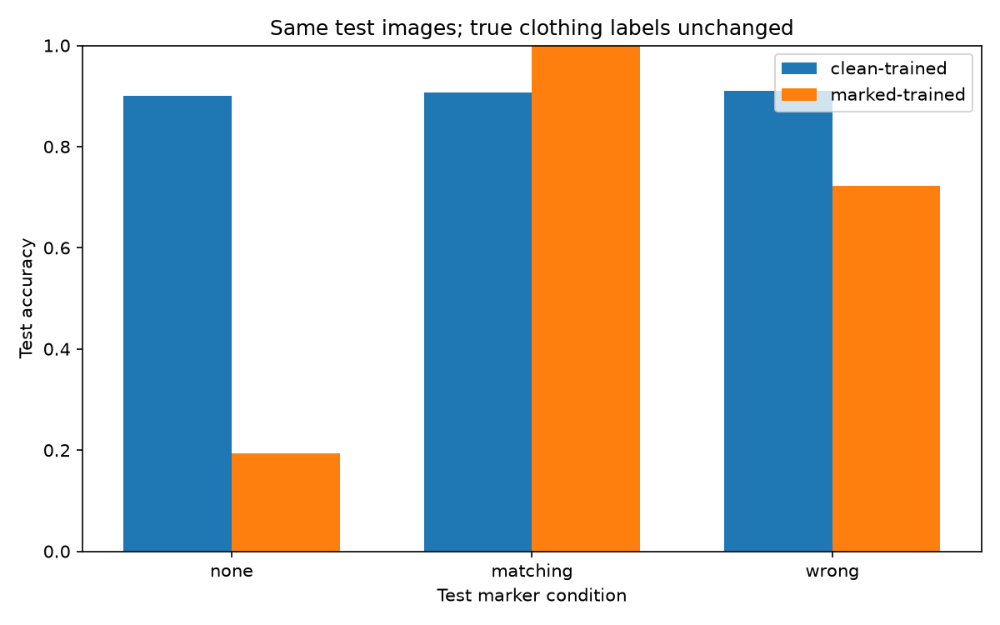

# Fashion-MNIST marker experiment: results

Run: `mac-run1`, completed locally on 22 November 2026. Summary documented on
24 November 2026. These are measured results, not expected outcomes.

The CNN trained with a class-linked corner square was highly sensitive to that
square: accuracy fell from 99.88% with matching markers to 19.31% without markers
and 72.24% with wrong markers. The clean-trained CNN stayed near 90–91% across
all three conditions. This supports marker reliance in this run, but does not
show that the marked model learned no clothing features.

## Experiment setup

Fashion-MNIST contains 28×28 grayscale images in ten clothing categories. The
official training data was split into 54,000 training and 6,000 validation images
using seed 42. Both frozen models were evaluated on the same official 10,000 test
images, in the same order. True clothing labels stayed unchanged throughout.

Both models used the original notebook's CNN: two 3×3 convolution layers with
32 and 64 channels, ReLU activations and max pooling, followed by 128 dense units,
dropout, and ten output scores. Preprocessing was `ToTensor()` only, giving pixel
values in [0, 1]. Training used five epochs, batch size 64, Adam, and cross-entropy
loss. The selected learning rate was 0.001 and dropout was 0.25.

The clean model trained on original images. The marked model trained with a
4×4 top-left square whose shade identifies the true class: ten evenly spaced
shades from 0.15 to 0.95. Paired training used the same architecture, settings,
initialization seed, split, and shuffled batch order. The selected clean trial's
final checkpoint was reused rather than retrained.

Test conditions were:

- **No marker:** original image pixels, not a black square.
- **Matching:** square shade linked to the true clothing class.
- **Wrong:** square shade linked to `(true_label + 1) % 10`.

See the [marker examples](reports/mac-run1/tuning/marker_examples.png) and
[saved protocol](reports/mac-run1/evaluation/protocol.json).

## Validation comparison

Only clean validation performance selected the settings. The rule was highest
final-epoch validation accuracy, with lower validation loss breaking a tie.
All four trials used five epochs, batch size 64, and seed 42.

| Learning rate | Dropout | Validation accuracy | Validation loss |
| --- | --- | ---: | ---: |
| 0.001 | 0.25 | 90.87% | 0.2493 |
| 0.001 | 0.50 | 90.62% | 0.2576 |
| 0.0003 | 0.25 | 89.62% | 0.2897 |
| 0.0003 | 0.50 | 88.70% | 0.3088 |

The first configuration won; it also matches the original notebook's settings.
The marked model then used those settings without a separate search. Its final
matching-marker validation accuracy was 99.82%; this is a different input condition
from clean validation, not a directly comparable measure of clothing recognition.

Sources: [validation measurements](reports/mac-run1/tuning/validation_comparison.csv),
[selection record](reports/mac-run1/tuning/selection.json), and
[marked training record](reports/mac-run1/final/marked/record.json).

## Final test results

Each row uses all 10,000 test images. Accuracy is the percentage of correct
clothing predictions. Cross-entropy loss also reflects confidence; lower is better.

| Training images | Test condition | Accuracy | Cross-entropy loss |
| --- | --- | ---: | ---: |
| Clean | No marker | 90.06% | 0.2683 |
| Clean | Matching marker | 90.74% | 0.2490 |
| Clean | Wrong marker | 91.05% | 0.2431 |
| Marked | No marker | 19.31% | 61.1402 |
| Marked | Matching marker | 99.88% | 0.0059 |
| Marked | Wrong marker | 72.24% | 13.7068 |

Source: [full-precision test results](reports/mac-run1/evaluation/test_results.csv).

For the marked model, removing a matching marker reduced accuracy by **80.57
percentage points**; replacing it with the specified wrong marker reduced accuracy
by **27.64 points**. Percentage points are the difference between two percentages,
not a relative percentage decrease. The clean model changed much less: removing
the matching marker reduced accuracy by 0.68 points, while using the wrong marker
increased it by 0.31 points. These are descriptive differences, not significance tests.

With wrong markers, the marked model predicted the marker's assigned class on
18.79% of images, versus 0.37% for the clean model. The marked model therefore did
not simply follow every wrong marker. Its high matching-marker accuracy also does
not establish better clothing recognition: those markers deliberately reveal the
correct label. The very large loss without markers is consistent with confident
incorrect predictions, not just a larger count of errors.

## Plots and supporting evidence

Training loss/accuracy curves and their per-epoch measurements:

- Clean model: [plot](reports/mac-run1/final/clean/learning_curves.png),
  [history](reports/mac-run1/final/clean/history.csv).
- Marked model: [plot](reports/mac-run1/final/marked/learning_curves.png),
  [history](reports/mac-run1/final/marked/history.csv).

Confusion matrices show true classes on rows and predicted classes on columns.
Diagonal entries are correct predictions; off-diagonal entries are class mix-ups.

| Test condition | Clean-trained CNN | Marker-trained CNN |
| --- | --- | --- |
| No marker | [Matrix](reports/mac-run1/evaluation/confusion_clean_none.png) | [Matrix](reports/mac-run1/evaluation/confusion_marked_none.png) |
| Matching | [Matrix](reports/mac-run1/evaluation/confusion_clean_matching.png) | [Matrix](reports/mac-run1/evaluation/confusion_marked_matching.png) |
| Wrong | [Matrix](reports/mac-run1/evaluation/confusion_clean_wrong.png) | [Matrix](reports/mac-run1/evaluation/confusion_marked_wrong.png) |

The snapshot also includes the matrix counts as CSV files,
[accuracy differences](reports/mac-run1/evaluation/marker_effects.csv), and aligned
per-image predictions for the [clean](reports/mac-run1/evaluation/predictions_clean.csv)
and [marked](reports/mac-run1/evaluation/predictions_marked.csv) models.
In the results CSV, `prediction_change_vs_none` compares predictions against
the no-marker condition, not against matching markers.

## Limitations and honest interpretation

- This is one seed, split, architecture, training budget, and marker design.
  There are no repeated-run uncertainty estimates or significance claims.
- Wrong markers are still a deterministic function of the true label, not
  independent random noise. Classes 0–8 move to the next shade; class 9 wraps
  from 0.95 to 0.15. This tests one particular intervention, not every wrong marker.
- The square also replaces 16 image pixels. Effects can include occlusion and a
  change in the input distribution; the clean model provides a useful control.
- The reference notebook had already exposed an official-test baseline result.
  This local run selected settings using validation only, but the project cannot
  describe the test set as never previously inspected.
- The notebook's stored 90.48% baseline test accuracy is a separate result from
  this local clean-model accuracy of 90.06%. Do not combine them as repeated trials.

## Reproducibility and next steps

The recorded environment was Python 3.14.2, PyTorch 2.11.0, torchvision 0.26.0,
NumPy 2.4.2, and Matplotlib 3.11.1, using Apple's `mps` device. See the
[README](README.md#run-on-this-mac) for commands to repeat the stages in a new
output folder. Different devices or environments may produce different results.

`reports/mac-run1/` is a compact, unchanged copy of the measured tables,
predictions, plots, and run records, eligible for Git alongside this summary.
The complete original run, including model weights, remains in the ignored local
`results/mac-run1/` folder. Nothing was retrained to write this document.

Use this as the evidence record for the course report's setup, results, and
discussion sections. The remaining deliverables are the full research-style
report and presentation; this summary is not a substitute for them.
